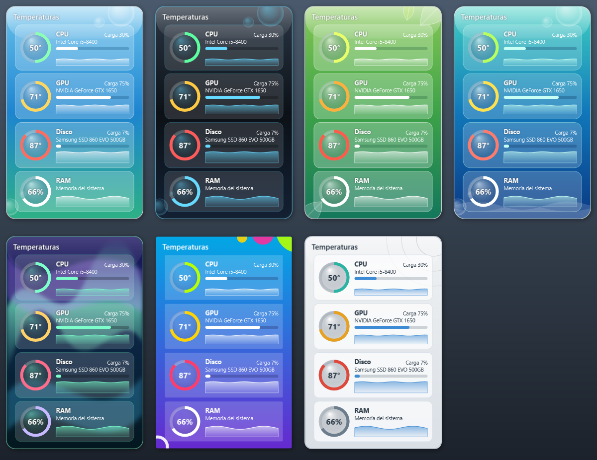
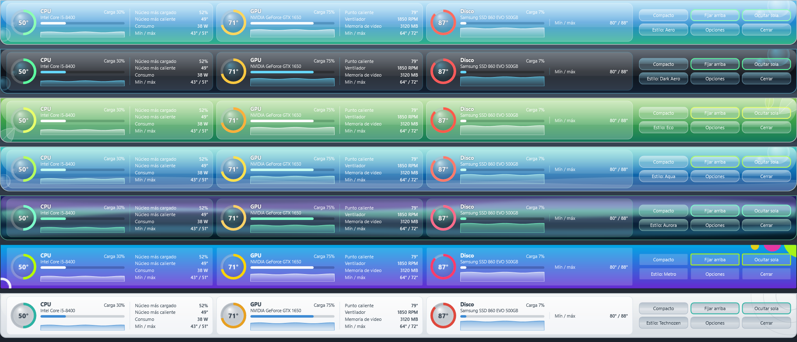

# TempWidget

A Windows desktop widget that shows your PC's temperatures, load and recent history, styled after the
glossy Frutiger Aero look of the Windows 7 gadget era. The interface is in Spanish.





## Features

- **Two layouts**: a compact card for a corner of the desktop, or a bar across the top of the screen that
  tucks itself away when the cursor leaves and comes back when the cursor touches the top edge. Neither one
  reserves screen space, so other windows are never pushed around.
- **Per component**: temperature ring that changes color as it heats up, load bar, a one-minute history graph,
  session minimum and maximum, and extra readings (hot spot, fan speed, power, video memory, clock).
- **Seven styles**: Aero, Dark Aero, Eco, Aqua, Aurora, Metro and Technozen.
- **Tray icon** that shows the hottest temperature as a colored number.
- **Overheat alerts**: a Windows notification (and optional sound) after five readings in a row over a
  limit you choose, re-armed only once the part cools down.
- **Reading log**: daily CSV files that open as columns in a spreadsheet.
- **Options**: Celsius or Fahrenheit, 100 / 125 / 150 % size, idle transparency, which components to show,
  click-through mode for gaming, start with Windows, hide to tray. Choices are remembered.

## Requirements

- Windows 10 or 11, 64-bit.
- To build: the [.NET 10 SDK](https://dotnet.microsoft.com/download).
- CPU temperature, CPU power and clocks, and motherboard sensors need the
  [PawnIO](https://pawnio.eu) driver and running the widget as administrator. Without them the widget still
  shows GPU temperature and CPU, GPU and memory load, and explains what is missing.

## Build and run

```bash
dotnet run
```

Self-contained build that runs on a PC without .NET installed:

```bash
dotnet publish -c Release -r win-x64 --self-contained -o publish
```

Draw every style in both layouts to `compacto.png` and `barra.png` without opening a window:

```bash
TempWidget.exe --captura <folder>
```

Settings and the reading log live in `%APPDATA%\TempWidget`.

## How it is built

- WPF on .NET 10. Each style is one record in `Theme.cs`; the window reads every color through resources,
  so adding a style is adding one entry.
- Sensor data from [LibreHardwareMonitor](https://github.com/LibreHardwareMonitor/LibreHardwareMonitor)
  (MPL-2.0), read on a background thread once a second.
- Tray icon through Windows Forms' `NotifyIcon`; the icon is drawn on the fly with the current temperature.
- The app icon is generated by `herramientas/icono.ps1`.
- Debug builds run a set of self-checks at startup (ring levels, history bounds, alert timing, unit
  conversion, CSV format, style definitions).
